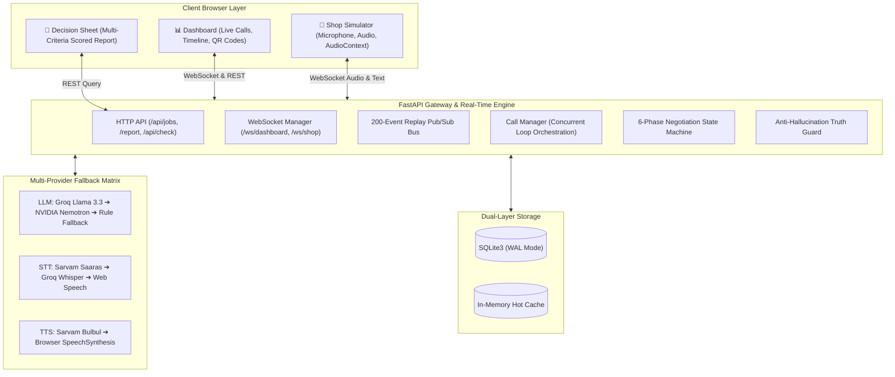

<div align="center">

```
  ██████╗ ██╗  ██╗ █████╗  █████╗ ██╗   ██╗
  ██╔══██╗██║  ██║██╔══██╗██╔══██╗██║   ██║
  ██████╔╝███████║███████║███████║██║   ██║
  ██╔══██╗██╔══██║██╔══██║██╔══██║╚██╗ ██╔╝
  ██████╔╝██║  ██║██║  ██║██║  ██║ ╚████╔╝ 
  ╚═════╝ ╚═╝  ╚═╝╚═╝  ╚═╝╚═╝  ╚═╝  ╚═══╝  
```

# Bhaav (भाव / ಬೆಲೆ)
### *Autonomous Voice AI Negotiation Agent with Verifiable Evidence Receipts*

[](https://python.org)
[](https://fastapi.tiangolo.com)
[](https://react.dev)
[](https://www.typescriptlang.org)
[](https://groq.com)
[](https://build.nvidia.com)
[](https://sarvam.ai)
[](#tests)

---

**Built in 8 Hours for the National AI Hackathon (RUAS Bengaluru)**  
*Live Demo • Real-time WebSockets • Multi-dialing • Verifiable Receipts*

</div>

---

## 💡 The Problem
In Indian cities like Bengaluru, fixing a broken phone screen means calling 5 to 10 local repair shops one by one. Each phone call takes 10–15 minutes, shopkeepers negotiate in varying languages (Hindi, Kannada, English), and quotes are difficult to compare:
- One shop quotes **₹3,800** with no warranty and an unconfirmed aftermarket part.
- Another shop quotes **₹4,200** with 6 months warranty and genuine OEM display.
- Customers accept the first quote out of exhaustion, leaving hundreds of rupees on the table.

## ⚡ The Solution: Bhaav
**Bhaav** acts as your personal autonomous procurement agent. You enter what you need fixed and your priorities (Price, Warranty, Turnaround, Quality). Bhaav immediately:
1. **Dials all 3 shops in parallel** over real-time WebSockets.
2. **Speaks and listens in the shopkeeper's preferred language** (Hindi, Kannada, English).
3. **Pushes quotes dynamically** using *actual, verified competing bids* collected during the session.
4. **Delivers an evidence-backed report** with audio clips, verbatim timestamps, and customizable multi-criteria weights.

---

## 🏛️ System Architecture



---

## 🚀 Key Features

- **Parallel Autonomous Negotiation:** Runs multiple concurrent call loops with independent timeouts, speech recognition, and response state machines.
- **Multilingual Indic Speech Support:** Fluidly processes conversations in **English**, **Hindi (हिन्दी)**, and **Kannada (ಕನ್ನಡ)** with automatic translation for the user dashboard.
- **Strict Anti-Hallucination & Truth Guard:**
  - Mandatory AI disclosure on call greeting: *"Hello, I am Bhaav, an AI assistant calling for a customer."*
  - **Zero Price Fabrication:** The agent *only* quotes prices actually recorded in the session database.
  - **No Commitment to Buy:** Never authorizes purchases or charges.
  - **Contradiction Detection:** Flags price shifts and discrepancies immediately.
- **Sub-4.0s Conversational Audio Budget:**
  - TTS is synthesized with a strict 1.2-second budget.
  - `agent_audio` is sent *first* only if generated within the window; otherwise gracefully falls back to `agent_text` for instant client-side speech synthesis. Never plays audio after text.
- **Evidence-Backed Decision Receipts:** Clicking any cell on the final report opens an interactive drawer featuring the exact transcript turn, translation, and audio timestamp proof.
- **Interactive Multi-Criteria Re-Weighting:** Dynamically recalculate scores in real-time by adjusting sliders for Price, Warranty, Speed, and Quality.

---

## 🛠️ Tech Stack

| Layer | Technologies |
|---|---|
| **Backend** | Python 3.11, FastAPI, Uvicorn (ASGI), Pydantic v2, HTTPX, WebSockets, SQLite3 (No ORM) |
| **Frontend** | React 19, TypeScript, Vite 8, TailwindCSS v4, React Router v7 |
| **Primary LLM** | Groq (`llama-3.3-70b-versatile`) — Ultra-low latency inference |
| **Secondary LLM** | NVIDIA NIM (`nvidia/nemotron-3.5-lightning-30b-a3b`) |
| **Indic Speech (STT/TTS)** | Sarvam AI (`saaras:v2` / `bulbul:v3`) |
| **Speech Fallback** | Groq Whisper (`whisper-large-v3`) & HTML5 Web Speech API |
| **Testing** | Pytest, Pytest-Asyncio (57 unit/integration tests) |

---

## 🏁 Quickstart (Local Development)

### Prerequisites
- Python 3.11+
- Node.js 20+ and npm

### 1. Clone & Setup Backend
```bash
git clone https://github.com/aniruddhaskr236/AI-Negotiator-RUAS-.git
cd AI-Negotiator-RUAS-

# Create Python virtual environment
python -m venv .venv
# Windows:
.venv\Scripts\activate
# Linux/macOS:
source .venv/bin/activate

# Install dependencies
pip install -r backend/requirements.txt
```

### 2. Configure Environment Variables
Create a `.env` file in the project root:
```env
GROQ_API_KEY=your_groq_api_key_here
NVIDIA_API_KEY=your_nvidia_api_key_here
SARVAM_API_KEY=your_sarvam_api_key_here
GROQ_MODEL=llama-3.3-70b-versatile
NVIDIA_MODEL=nvidia/nemotron-3.5-lightning-30b-a3b
DB_PATH=bhaav.db
SCRIPTED_SHOPS=0
DEMO_CONTROLS_ENABLED=true
LOG_LEVEL=INFO
```

### 3. Setup Frontend
```bash
cd frontend
npm install
npm run build
cd ..
```

### 4. Run the Servers

**Option A — Unified Production Server (Backend + Built Frontend):**
```bash
python -m uvicorn backend.main:app --host 127.0.0.1 --port 8000
```
Open **[http://localhost:8000](http://localhost:8000)** in your browser!

**Option B — Live Development Mode (Vite Hot-Reload):**
```bash
# Terminal 1: Backend
python -m uvicorn backend.main:app --host 127.0.0.1 --port 8000

# Terminal 2: Frontend Vite
cd frontend
npm run dev -- --port 5173
```
Open **[http://localhost:5173](http://localhost:5173)**.

---

## 🧪 Testing & Verification

The codebase includes comprehensive unit and integration tests covering the state machine, audio normalizers, LLM fallback chain, and scoring engine:

```bash
# Run full backend test suite
pytest -q
```
```text
.........................................................                [100%]
57 passed in 7.34s
```

Run pre-flight dependency & system check:
```bash
python scripts/check_env.py
```

Run end-to-end automated smoke test:
```bash
python scripts/smoke.py
```

---

## 📡 API & WebSocket Reference

### HTTP Endpoints

| Method | Path | Description |
|---|---|---|
| `GET` | `/health` | Health check endpoint (`{"ok": true}`) |
| `POST` | `/api/jobs` | Dispatches new negotiation job and initiates calls |
| `POST` | `/api/jobs/{job_id}/calls/{call_id}/retry` | Retries a dropped or failed call |
| `GET` | `/api/jobs/{job_id}/report` | Fetches evidence-backed decision report with custom weights |
| `GET` | `/api/check` | Diagnostics report for database, LLMs, and speech APIs |
| `POST` | `/api/demo/fail` | Demo trigger for edge cases (`hangup`, `price_change`, `kill_provider`, `unclear_audio`) |

### WebSocket Channels

- **Shop Interface:** `/ws/shop/{shop_id}`
  - Receives: `ring`, `agent_text`, `agent_audio`, `end`
  - Sends: `answer`, `audio` (base64 WebM), `text` (typed fallback), `hangup`, `ping`
- **Dashboard Stream:** `/ws/dashboard/{job_id}`
  - Receives real-time broadcast: `call_status`, `turn`, `offer`, `conflict`, `timeline`, `health`, `report_ready`

---

## ☁️ Deployment (Render)

This repository includes a battle-tested `render.yaml` blueprint ready for zero-downtime deployment:

1. Connect this GitHub repo to [Render](https://render.com).
2. Create a new **Web Service** or **Blueprint**.
3. Set your environment variables (`GROQ_API_KEY`, `NVIDIA_API_KEY`, `SARVAM_API_KEY`).
4. Render automatically compiles the frontend with `npm ci && npm run build` and boots Uvicorn with the FastAPI ASGI application.

---

## 🔒 Safety & Responsible AI Guarantees

Bhaav is engineered around four core safety pillars:
1. **AI Transparency:** Call recipients are immediately informed they are talking to an AI assistant.
2. **Verifiable Citations:** Negotiating agents cannot bluff with fictional prices.
3. **User Autonomy:** The AI never commits financial resources or signs agreements.
4. **Contradiction Resolution:** Ambiguities are actively surfaced to both the shopkeeper and the end-user.

---

## 📄 License

This project was developed for the RUAS Hackathon under the **MIT License**.