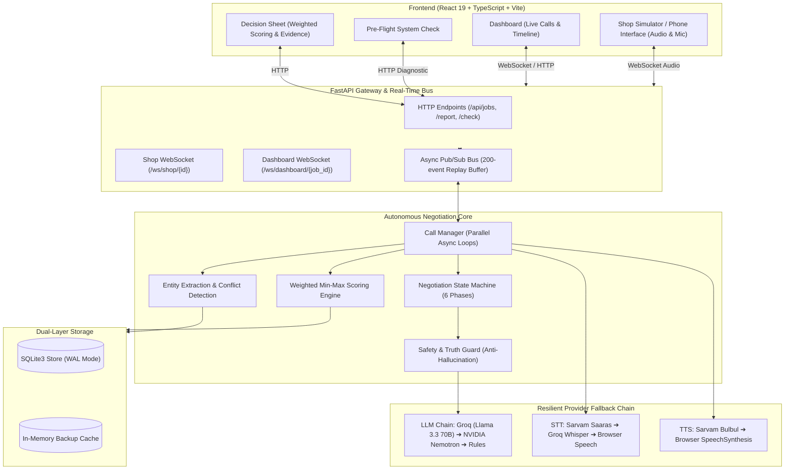
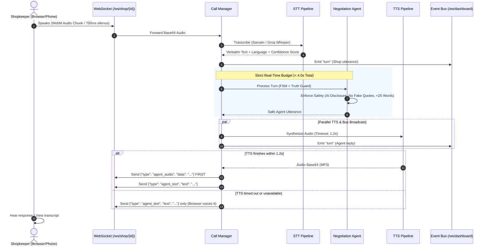
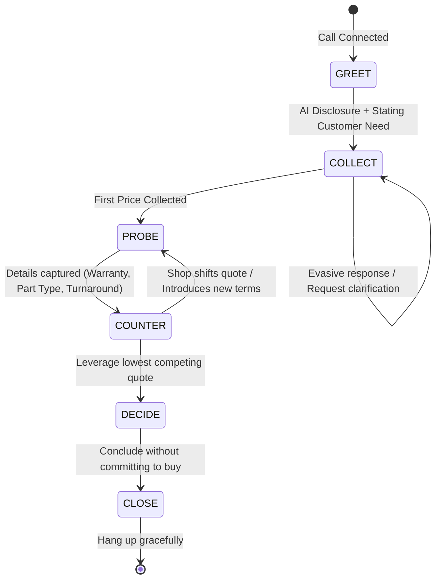
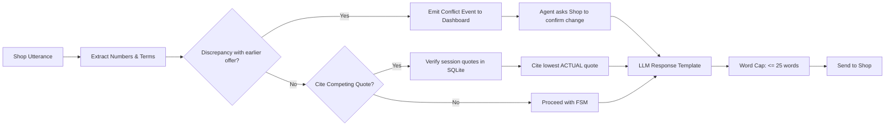
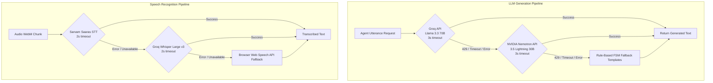

# Bhaav (भाव) — System Architecture

> **Autonomous Multilingual Voice Negotiation Agent with Verifiable Evidence Receipts**

---

## 1. High-Level System Overview

Bhaav is an autonomous voice AI agent designed to phone local repair shops simultaneously, converse in the shopkeeper's preferred language (Hindi, Kannada, or English), negotiate prices using verified competing offers, and generate a mathematically weighted, evidence-backed decision report.

---

## 2. Real-Time Voice & Audio Pipeline

Every phone call operates with strict time-budget guarantees to prevent dead air and maintain natural conversational cadence.

---

## 3. Negotiation State Machine (FSM)

The agent moves strictly through six deterministic states, preventing loops and infinite negotiations:

### State Definitions & Constraints:
1. **GREET:** Introduces the AI caller clearly: *"Hello, I am Bhaav, an AI assistant calling on behalf of a customer in Bengaluru."*
2. **COLLECT:** Asks for initial diagnostic quote and timeline for the specific phone model and issue.
3. **PROBE:** Inquires about part authenticity (OEM vs Aftermarket), warranty duration, and turnaround time.
4. **COUNTER:** Pushes back with actual verified lower quotes from competing shops in the current session.
5. **DECIDE:** Summarizes the final terms without ever committing the customer to buy.
6. **CLOSE:** Politely thanks the shopkeeper, concludes the call, and records final receipts.

---

## 4. Anti-Hallucination & Safety Guardrails

- **Rule 1 (AI Disclosure):** The caller explicitly states it is an AI assistant on the opening turn.
- **Rule 2 (Receipt-Backed Counters):** The agent **never** invents prices. It strictly queries verified quotes recorded in `store.py` for the current job session.
- **Rule 3 (No Purchase Commitment):** The agent never accepts or finalizes a purchase, only gathers offers for the customer.
- **Rule 4 (Contradiction Detection):** If a shopkeeper changes price (e.g. from ₹4500 to ₹3800, or vice versa), a `conflict` event is broadcast and the agent prompts confirmation.

---

## 5. Multi-Provider Fallback Architecture

To survive hackathon rate limits and API outages, Bhaav implements an asynchronous tiered fallback:

---

## 6. Mathematical Scoring Engine

The recommendation report evaluates each shop $i$ using a weighted normalized score:

$$
\text{Score}_i = \left( w_{\text{price}} \cdot S_{\text{price}, i} \right) + \left( w_{\text{warranty}} \cdot S_{\text{warranty}, i} \right) + \left( w_{\text{speed}} \cdot S_{\text{speed}, i} \right) + \left( w_{\text{quality}} \cdot S_{\text{quality}, i} \right)
$$

Where weights sum to $100$ ($w_p + w_w + w_s + w_q = 100$), and normalized sub-scores ($0 \le S \le 100$) are calculated as:

- **Price Score:** 
  $$S_{\text{price}, i} = \frac{\min_{j} (\text{Price}_j)}{\text{Price}_i} \times 100$$
- **Warranty Score:** 
  $$S_{\text{warranty}, i} = \frac{\min(\text{WarrantyMonths}_i, 6)}{6} \times 100$$
- **Speed Score:** 
  $$S_{\text{speed}, i} = \frac{1}{\text{ETADays}_i} \times 100$$
- **Part Quality Score:** 
  $$\text{OEM} \to 100, \quad \text{Aftermarket} \to 60, \quad \text{Unknown} \to 0$$

Failed calls (no answer or hangup before first quote) receive a score of $0.0$.
